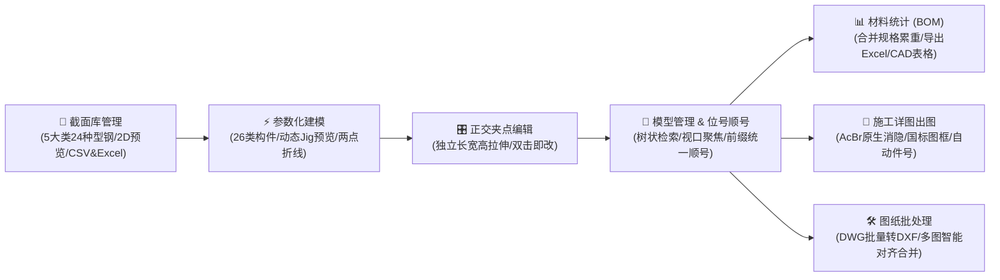

# SteelStructureSuite · 参数化钢结构套件

[](https://github.com/zly258/SteelStructureSuite/releases/latest)
[](LICENSE)
[](README.md#三环境要求)
[](README.md#三环境要求)
[](README.md#二环境要求)
[](CONTRIBUTING.md)
[](https://ifdian.net/order/create?user_id=3db8e630e6dc11f1b37452540025c377)

**SteelStructureSuite** 是一款面向 **AutoCAD (x64)** 平台的高性能参数化钢结构设计套件。以 Autodesk Bundle 规范深度集成，随 AutoCAD 启动自动加载并在顶部生成专属「参数化钢结构」功能区。

套件全面覆盖**门式刚架、平台、管廊、桁架、梯道、栏杆、支座**，以及**化工、电力、冶金三大工业行业的 8 类标准参数化组件**（共计 **26 种**构件类型）。为工程设计师与深化人员提供**参数化交互建模、全正交自主夹点编辑、全图模型资产管理、工程材料统计（BOM）与国标图框消隐详图出图**等全流程解决方案。

---

## 一、核心特性



* 📐 **5 大类 24 种型钢截面库（176 条预置规格）**：涵盖热轧标准型钢（H/I/C/等边与不等边角钢/T）、焊接与组合型钢（焊接 H/不等翼缘焊接 H/箱型/焊接 T/十字/双角钢/双槽钢）、冷弯薄壁型钢（卷边 C/卷边 Z/无卷边 Z/U/帽型钢）、空心钢管（方/矩/圆）与实心型材（扁/圆/方钢）；支持左树右表检索、2D 实时轮廓预览、国标手册单重/面积预置与手工修正，以及外部独立 CSV 数据文件管理。
* 📦 **26 类行业标准参数化构件**：包含厂房刚架、四柱平台、空间管廊、螺旋盘梯、直跑斜梯、安全栏杆，以及塔器检修平台、立式裙座、加劲管托、储罐拱顶栏杆、变电龙门构架、电缆沟支架、冶金重型吊车梁与柱间支撑。
* ⚡ **动态预览与灵活绘制**：支持单点动态落位（实体轮廓实时跟随光标）、两点定向拉伸绘制，以及 `SS_LINEAR_CHAIN` 连续折线绘制栏杆、走道与钢梁。
* 🎛️ **自主正交夹点拉伸**：突破原生块/组限制，提供长度、高度、宽度与原点独立拉伸夹点，互不串扰干扰；支持双击实体直接唤起参数配置界面。
* 🔢 **模型管理检索 & 独立位号顺号（`SS_RENUMBER`）**：
  * **模型管理器**：左树右表直观分类与顶部模糊检索，双击表格行视口自动平滑缩放聚焦并高亮定位。
  * **位号顺号**：支持强制统一前缀并顺号 / 仅统一前缀 / 仅顺号三种策略，自定义编号位数（默认 3 位如 `001`）、26 类构件默认前缀预设与前后对比预览。
* 📐 **工程级施工详图与原生消隐**：基于 AutoCAD AcBr 原生实体边界压平与消隐，输出标准 A1~A4 国标图框；正/侧/平面按标准工程符号投影，轴测图件号均匀避让成环，自动生成带构件明细的工程详图。
* 📊 **BOM 算量统计与多图批处理**：自动按截面规格、材质与单长合并统计并累加重量，内置 OpenXML 引擎直接导出 `.xlsx` 或插入 CAD 原生表格；支持多图智能对齐合并与独立子进程稳定批量转 DXF；全插件窗口原生适配双屏/异 DPI 精准跟随 AutoCAD 主窗口屏幕弹出。

---

## 二、快速开始与安装指南

### 方式一：EXE 安装包一键安装（强烈推荐工程设计师使用）

适合广大学员、工程师与深化设计人员，无需配置任何开发环境：

1. **下载安装包**：前往本仓库 [GitHub Releases 页面](https://github.com/zly258/SteelStructureSuite/releases/latest) 下载最新版本的 `SteelStructureSuite-1.1.0-setup.exe`。
2. **运行安装**：双击运行安装向导，按提示点击「下一步」即可完成安装。
   * 安装包采用统一多版本自适应 Bundle 架构，内置 **AutoCAD 2019~2020 (R23)**、**AutoCAD 2021~2024 (R24)** 与 **AutoCAD 2025~2026 (R25, .NET 8)** 三个运行时模块。
   * 自动注册至受 `SECURELOAD=1` 默认信任的系统级插件目录 `C:\Program Files\Autodesk\ApplicationPlugins\SteelStructureSuite.bundle\`。
3. **启动使用**：打开 AutoCAD（2019 ~ 2026 任意版本），顶部 Ribbon 菜单将自动出现 **「参数化钢结构」** 选项卡，点击任意构件按钮即可开始建模。
4. **一键卸载**：若需卸载，可在 Windows「设置 → 应用和功能」或控制面板中找到「参数化钢结构套件」一键干净卸载，绝不残留垃圾文件。

> [!TIP]
> 安装前请建议先关闭正在运行的 AutoCAD 进程，避免 DLL 文件因被占用而无法覆盖。

---

### 方式二：手动放置 Bundle（绿色免安装）

解压 Release 发布的 `SteelStructureSuite-bundle-1.1.0.zip` 至受信任插件目录：

```text
C:\Program Files\Autodesk\ApplicationPlugins\
└─ SteelStructureSuite.bundle\          # 统一自适应支持 AutoCAD 2019 ~ 2026
   ├─ PackageContents.xml
   └─ Contents\
      ├─ 2019\SteelStructureSuite.dll   # AutoCAD 2019 ~ 2020 (R23, .NET 4.8)
      ├─ 2021\SteelStructureSuite.dll   # AutoCAD 2021 ~ 2024 (R24, .NET 4.8)
      ├─ 2026\SteelStructureSuite.dll   # AutoCAD 2025 ~ 2026 (R25, .NET 8.0)
      ├─ Data\DefaultSectionCatalog.csv # 默认型钢截面库（UTF-8 CSV）
      └─ Help\UserManual.md
```

重启 AutoCAD 即可自动识别加载。

---

### 方式三：NETLOAD 命令手工加载（开发者调试）

1. 打开 AutoCAD 命令行，输入 `NETLOAD`。
2. 浏览并选中编译产物 `SteelStructureSuite.dll`。
3. 加载成功后在命令行执行 `SS_RIBBON` 即可激活顶部功能区。

---

## 三、环境要求

| 配置项 | 最低要求 | 推荐配置 / 说明 |
| :--- | :--- | :--- |
| **操作系统** | Windows 10 x64 | Windows 10 / 11 64 位简体中文版 |
| **AutoCAD 平台** | AutoCAD 2019 (R23.0) | AutoCAD / AutoCAD Plant 3D **2019 ~ 2026** (64位) |
| **目标框架** | .NET Framework 4.8 / .NET 8.0 | 2019~2024 使用 .NET 4.8，2025~2026 使用 .NET 8.0（AutoCAD 自带运行时） |
| **编译工具** | Visual Studio 2022 | MSBuild (`Debug|x64` 或 `Release|x64`) |
| **打包工具** | Inno Setup 6.x | 含简体中文语言包，用于构建单文件 EXE 安装包 |

> [!IMPORTANT]
> **多版本程序集兼容说明**：  
> AutoCAD 托管核心程序集（`AcDbMgd`、`AcCoreMgd`、`AcMgd`、`AdWindows`）随 CAD 主版本递增（2019~2020 为 `R23 / .NET 4.8`，2021~2024 为 `R24 / .NET 4.8`，2025~2026 为 `R25 / .NET 8.0`）。  
> 本项目原生支持多目标框架编译，并在统一 `SteelStructureSuite.bundle` 中同时内置 R23、R24、R25 三个运行时模块，各版本 AutoCAD 启动时按 `PackageContents.xml` 自动匹配加载。

---

## 四、26 种参数化构件清单与参照标准

本项目构件严格参考国家现行标准、化工行业标准、电力规程与冶金标准图集设计参数化几何模型：

| 行业大类 | 构件名称 | 快捷命令 | 参照规范 / 图集标准 | 绘制模式 |
| :--- | :--- | :--- | :--- | :--- |
| **厂房与装置框架** | 单跨门式刚架 | `SS_PORTAL` | GB 51022《门式刚架轻型房屋钢结构技术规范》 | 单点放置 |
| | 多跨门式刚架 | `SS_MULTIPORTAL`| GB 51022《门式刚架轻型房屋钢结构技术规范》 | 单点放置 |
| | 人字斜撑框架 | `SS_BRACED` | GB 50017《钢结构设计标准》 | 单点放置 |
| | 双层管廊支架 | `SS_DOUBLE` | HG/T 20670《化工装置设备管道布置设计技术规定》 | 单点放置 |
| | 多层空间装置框架 | `SS_SPACEFRAME`| GB 50017《钢结构设计标准》 | 单点放置 |
| | 双坡屋面桁架 | `SS_TRUSS` | 05G515《轻型屋面钢梯形屋架》 | 单点放置 |
| **平台梯道与栏杆** | 四柱空间平台 | `SS_PLATFORM` | GB 50017《钢结构设计标准》、GB 4053 系列 | 单点放置 |
| | 悬臂三角托架 | `SS_BRACKET` | GB 50017《钢结构设计标准》 | 单点放置 |
| | 悬挑检修走道 | `SS_WALKWAY` | GB 4053.3《工业防护栏杆及钢平台》 | 单点 / 两点 / 连续折线 |
| | 空间管廊桁桥 | `SS_PIPEBRIDGE`| HG/T 21629《管架标准图》 | 单点 / 两点 / 连续折线 |
| | 螺旋盘梯 | `SS_STAIR` | GB 4053.2《固定式钢梯及平台 安全要求》 | 单点放置 |
| | 直跑钢斜梯 | `SS_STAIR_STRAIGHT`| GB 4053.2《固定式钢梯及平台 安全要求》 | 单点 / 两点定向 |
| | 护笼钢直梯 | `SS_LADDER` | GB 4053.1《钢直梯安全要求》 | 单点放置 |
| | 安全栏杆 | `SS_HANDRAIL` | GB 4053.3《工业防护栏杆及钢平台》 | 两点 / 连续折线 |
| **化工设备标准件** | 塔器环形检修平台 | `SS_TOWER_PLAT`| HG/T 21543《圆形塔平台通用图》、GB 4053.3 | 单点（60°~360°包角） |
| | 立式塔器钢裙座 | `SS_SKIRT` | NB/T 47041《塔式容器》 | 单点放置 |
| | 化工管道加劲管托 | `SS_PIPESHOE` | HG/T 21629《管架标准图》 | 单点 / 两点定向 |
| | 储罐拱顶环形安全栏杆 | `SS_TANK_RAIL`| SH/T 3007、GB 4053.3 | 单点（60°~360°包角） |
| | 卧式容器鞍式支座 | `SS_SADDLE` | NB/T 47042《卧式容器鞍式支座》 | 单点放置 |
| **电力与冶金标准件** | 变电站 A 字型龙门构架 | `SS_GANTRY` | DL/T 5218《220kV~750kV变电站设计技术规程》 | 单点放置 |
| | 电力电缆沟多层支架 | `SS_CABLE_RACK`| DL/T 5221《城市电力电缆线路设计技术规定》 | 两点 / 连续多段线性 |
| | 冶金厂房重型吊车梁系统 | `SS_CRANE_BEAM`| 20G520-1~2《钢吊车梁》 | 两点线性 |
| | 冶金厂房柱间交叉支撑 | `SS_XBRACE` | 19G518-3《门式刚架轻型房屋钢结构(有吊车)》 | 两点线性 |
| **单根型钢与连续线** | 单根直线型钢 | `SS_MEMBER` | 热轧 / 焊接型钢标准（GB/T 11263 等） | 任意两点拾取 |
| | 单根弧形型钢 | `SS_ARC` | 支持选择圆弧、圆、圆弧多段线沿路径扫掠 | 拾取图元扫掠 |
| | 单根螺旋型钢 | `SS_SPIRAL` | 选择 AutoCAD 螺旋线（HELIX）连续扫掠 | 拾取图元扫掠 |

---

## 五、命令与功能区速查表

在 AutoCAD 命令行输入以下快捷命令即可直接调用相应功能：

### 1. 综合管理与出图

| 命令 | 对应功能区按钮 | 说明 |
| :--- | :--- | :--- |
| `SS_RIBBON` | 激活功能区 | 重新生成并显示顶部「参数化钢结构」选项卡 |
| `SS_MANAGER` | **【模型管理】** | 打开全图构件管理器，支持关键字检索、树状分类过滤、视口居中高亮、参数修改与删除 |
| `SS_RENUMBER` | **【位号顺号】** | 按构件类型前缀与编号位数批量顺号重排，支持强制统一前缀与顺号前后对比预览 |
| `SS_SECTIONS`| **【截面管理】** | 打开型钢截面数据库（5 大类 24 种截面），支持 2D 轮廓预览、手册单重修正与 Excel/CSV 导入导出 |
| `SS_BOM` | **【材料统计】** | 框选或全图提取构件材料明细，导出 Excel（.xlsx）或生成 CAD 统计图表 |
| `SS_DRAWING` | **【施工详图】** | 拾取构件生成国标 A1~A4 消隐施工图（支持正/侧/俯视图与轴测图引线） |
| `SS_DRAWCFG` | 出图设置 | 独立配置详图图幅、比例、视图勾选与输出目标（当前图纸 / 独立新 DWG） |
| `SS_HELP` | 内置帮助 | 弹出插件内置的图文使用指南手册 |
| `SS_ABOUT` | **【关于套件】** | 查看套件版本、版权信息与 GNU GPL v3.0 协议说明 |

### 2. 图纸批处理工具

| 命令 | 对应功能区按钮 | 说明 |
| :--- | :--- | :--- |
| `SS_DWGMERGE`| **【合并图纸】** | 批量载入多张 DWG/DXF 图纸，按各图实际模型边界自动计算间距并水平/垂直整齐排布 |
| `SS_DWG2DXF` | **【批量转DXF】** | 批量将 DWG 转换为指定 AutoCAD 版本的 DXF 文件（独立进程转换，稳定防崩溃） |

### 3. 定位、连续绘制与夹点辅助

| 命令 | 功能说明 |
| :--- | :--- |
| `SS_LINEAR_CHAIN` | 连续多段线折线绘制（支持安全栏杆、检修走道、连续型钢主梁） |
| `SS_EDIT` | 修改选中构件的参数与截面（亦可直接双击实体） |
| `SS_ALIGN` | 多构件在 X/Y/Z 或包围盒中心方向快速对齐 |
| `SS_ARRAY` | 沿指定轴向定距线性阵列并自动递增构件位号 |
| `SS_DROPZ0` | 构件整体沉底对齐，将底标高精确归零至 Z=0 平面 |
| `SS_OVERRULE_ON` | 启用自主正交参数拉伸夹点（默认常开） |
| `SS_OVERRULE_OFF` | 关闭参数夹点复写（回退为原生基础夹点） |
| `SS_RESETSETTINGS`| 清除本地界面设置记忆（恢复出厂默认预设值） |

---

## 六、开发者指南（源码编译与打包）

如果你是开发者或需要将插件扩展集成到企业环境，请遵循以下步骤：

### 1. 源码克隆

```bash
git clone https://github.com/zly258/SteelStructureSuite.git
cd SteelStructureSuite
```

### 2. 目录结构概览

```text
SteelStructureSuite/
├─ SteelStructureSuite.sln           # Visual Studio 解决方案
├─ README.md                         # 项目中文说明
├─ CHANGELOG.md                      # 版本更新日志
├─ CONTRIBUTING.md                   # 开源贡献指南
├─ LICENSE                           # GNU GPL v3.0 开源许可证
├─ docs/
│  └─ UserManual.md                  # 详细用户使用指南
├─ .github/                          # GitHub Issue 与 PR 模板
├─ installer/
│  ├─ PackageContents.xml            # AutoCAD 2019~2026 (R23~R25) 统一自适应 Bundle 描述清单
│  └─ SteelStructureSuite.iss        # Inno Setup 安装包构建脚本
├─ tools/
│  └─ Publish.ps1                    # 一键编译、多目标发布与安装脚本
└─ SteelStructureSuite/              # 核心源码工程
   ├─ Core/                          # 插件生命周期控制、动态扩展注入
   ├─ Commands/                      # AutoCAD 命令行注册（SS_*）
   ├─ Data/                          # 默认国标与工程截面库（DefaultSectionCatalog.csv）
   ├─ Domain/                        # 领域模型、参数规范与标准枚举
   ├─ Ribbon/                        # 顶部功能区界面布局构建
   ├─ Services/
   │  ├─ Catalog/                    # 5 大类 24 种型钢截面库与 Excel/CSV 导入导出
   │  ├─ Modeling/                   # 三维实体几何构造器与参数持久化
   │  ├─ Interaction/                # 动态 Jig 预览、自主夹点复写、主线程调度
   │  ├─ Settings/                   # 用户界面记忆、前缀预设与双屏窗口定位
   │  ├─ Takeoff/                    # 工程算量汇总与 Excel 报表输出
   │  └─ Drawing/                    # AcBr 原生边界消隐、图框排版与图纸合并
   ├─ Views/                         # WPF 紧凑主题窗口、2D 截面预览与工程示意图控件
   └─ Theme/                         # 界面密度与色彩设计令牌
```

### 3. MSBuild 编译解决方案

> [!WARNING]
> **切记使用 `/t:Rebuild`**：由于项目默认输出到固定的 `bin\x64\Release`，MSBuild 会依据时间戳做增量判断，可能导致代码更新后被跳过编译。请务必使用 `Rebuild` 清理旧缓存。

```powershell
# 1. 编译面向 AutoCAD 2019 (R23) 版本（默认）
msbuild SteelStructureSuite.sln /t:Rebuild /p:Configuration=Release /p:Platform=x64

# 2. 编译面向 AutoCAD 2021~2024 (R24, net48) 版本
msbuild SteelStructureSuite.sln /t:Rebuild /p:Configuration=Release /p:Platform=x64 ^
        /p:AutoCADDir="C:\Program Files\Autodesk\AutoCAD 2021" /p:TargetFramework=net48

# 3. 编译面向 AutoCAD 2025~2026 (R25, net8.0-windows) 版本
msbuild SteelStructureSuite.sln /t:Rebuild /p:Configuration=Release /p:Platform=x64 ^
        /p:AutoCADDir="C:\Program Files\Autodesk\AutoCAD 2026" /p:TargetFramework=net8.0-windows
```

### 4. 一键多版本发布与打包

本项目附带了自动发布脚本 `tools\Publish.ps1`：

```powershell
# 编译 R23 / R24 / R25 三大版本产物并生成 dist 目录包与安装包
pwsh tools\Publish.ps1

# 编译并直接安装到本机 AutoCAD 插件目录
pwsh tools\Publish.ps1 -Install
```

构建独立 EXE 安装包（依赖 Inno Setup 6）：

```powershell
"C:\Program Files (x86)\Inno Setup 6\ISCC.exe" /DAppVersion=1.1.0 installer\SteelStructureSuite.iss
```

构建完成后将在 `dist\` 目录下生成：
* `dist\SteelStructureSuite-1.1.0-setup.exe`：全功能自适应（2019~2026）独立安装包。
* `dist\SteelStructureSuite-bundle-1.1.0.zip`：免安装绿色 Bundle 压缩包。

---

## 七、常见问题排查 (FAQ)

<details>
<summary><b>Q1. 安装完成后打开 AutoCAD，顶部未出现「参数化钢结构」菜单？</b></summary>

1. 确认插件安装目录是否存在：检查 `C:\Program Files\Autodesk\ApplicationPlugins\SteelStructureSuite.bundle` 是否完整。
2. 检查 AutoCAD 安全设置：`C:\Program Files\Autodesk\ApplicationPlugins\` 默认受 `SECURELOAD=1` 信任；若手动移动了位置，请在「选项 → 文件 → 受信任的位置」中添加路径。
3. 手工执行一次 `SS_RIBBON` 激活界面。
</details>

<details>
<summary><b>Q2. 安装时弹出提示「文件正在被使用无法写入」？</b></summary>

这是由于后台仍有 `acad.exe` 进程在运行并锁定了插件 DLL。请打开任务管理器彻底结束所有 `AutoCAD` 进程，然后再重新运行安装包。
</details>

<details>
<summary><b>Q3. 在 AutoCAD 2021~2026 上使用出现“找不到命令”或“未处理的异常”？</b></summary>

AutoCAD 的托管程序集随主版本变化（2019~2020 为 `R23/.NET 4.8`，2021~2024 为 `R24/.NET 4.8`，2025~2026 为 `R25/.NET 8.0`）。自行源码编译请指定对应版本的 `AutoCADDir` 与 `TargetFramework`，或直接使用发布的安装包（已内置 R23/R24/R25 三个运行时并自动匹配）。
</details>

<details>
<summary><b>Q4. 双击实体无法弹出参数编辑窗口？</b></summary>

1. 确认该构件是由本插件生成的参数化实体（本插件生成的对象具有专属扩展字典数据）。
2. 在命令行执行 `SS_OVERRULE_ON` 确保夹点与事件复写已开启。
</details>

---

## 八、开源贡献与提交规范

欢迎各位开发者与行业专家提交 Issue 或 Pull Request！

* 提交 Commit 请严格遵循 [Conventional Commits](https://www.conventionalcommits.org/zh-hans/) 规范，并**使用规范中文**记录：
  * `feat: 新增变电站 A 字型龙门构架参数化模型`
  * `fix: 修复多图合并时空数据库释放导致的访问冲突`
  * `docs: 完善项目中文使用说明与发布安装指引`
  * `style: 统一所有界面对话框为紧凑设计令牌`
* 新增构件请参照现有构件实现：参数模型定义、几何构造、二维示意图、夹点复写与出图投影。
* 详细开发约定与代码审查规范请参阅 [CONTRIBUTING.md](CONTRIBUTING.md)。

---

## 九、规范标准与工程免责声明

* **标准构件参数化几何实现**：本项目所建立的构件模型严格依据公开的国家标准（GB）、化工行业标准（HG/T）、石化行业标准（SH/T）、电力行业标准（DL/T）以及国家建筑标准设计图集（G系列图集）规定的外形尺寸、构造形式与比例关系进行参数化建模。
* **无侵权声明**：本项目**不包含任何标准规范的扫描原文、标准图集原始 CAD 底图或任何第三方的商业专有图纸**。本项目与任何标准制定机构、出版社或设计院所无任何商业代理或隶属关系。
* **工程设计免责**：本项目提供的三维构件几何与工程算量数据供方案设计、空间布置、碰撞校核与快速方案算量参考，**不可未经结构受力计算与专业工程校审直接用于施工建造**。正式工程项目请严格依据现行工程设计规范进行承载力验算。

---

## 十、支持与打赏

如果本项目对你的日常设计或工程出图有所帮助，欢迎通过爱发电请作者喝一杯咖啡，你的支持将持续推动更多标准构件与出图功能的迭代：

* **直达打赏页**：[点击直接打赏（爱发电）](https://ifdian.net/order/create?user_id=3db8e630e6dc11f1b37452540025c377)
* **创作者主页**：[爱发电主页 · zhangly1403](https://ifdian.net/a/zhangly1403)

---

## 十一、开源许可证

本项目依据 **[GNU General Public License v3.0 (GPL-3.0)](LICENSE)** 协议开源。

你可以自由地使用、修改和再分发本软件；若分发修改版或衍生作品，必须同样以 GPL v3.0 协议开放源代码并保留版权与许可声明。完整条款请参阅仓库根目录的 [LICENSE](LICENSE) 文件。

Copyright © 2026 zhangly1403 · [zhangly1403@qq.com](mailto:zhangly1403@qq.com)