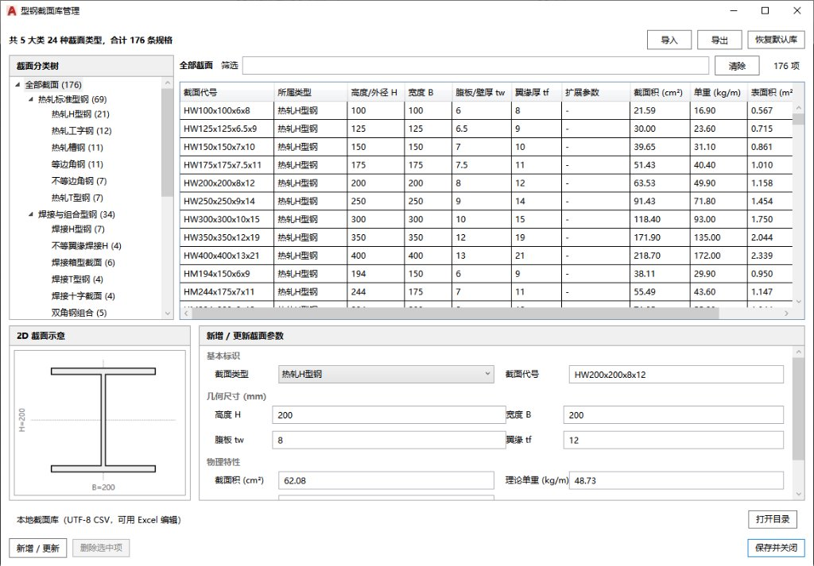
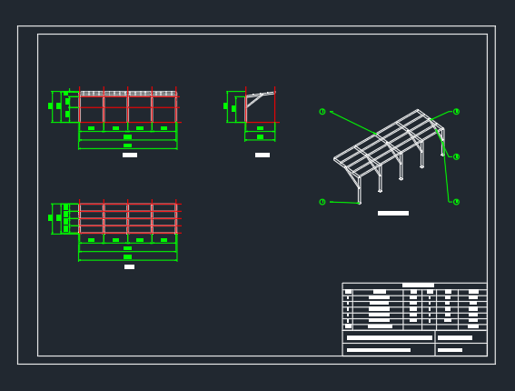

<h1 align="center">SteelStructureSuite</h1>

<p align="center">Parametric steel structure modeling, BOM takeoff, and engineering detailing suite for AutoCAD (x64).</p>

<p align="center">
  <a href="./README.md">English</a> | <a href="./README.zh-CN.md">简体中文</a>
</p>

<p align="center">
  <a href="https://github.com/zly258/SteelStructureSuite/releases/latest"></a>    <a href="./docs/UserManual.md"></a> <a href="./LICENSE"></a>
</p>

**SteelStructureSuite** is an AutoCAD (x64) plugin packaged as a unified Autodesk ApplicationPlugins Bundle. It loads automatically on AutoCAD startup, adds a dedicated Ribbon tab, and covers 34 parametric steel structure types (including 8 multi-member zone assemblies) across industrial buildings, platforms, stairs, pipe racks, walkways, canopies, and chemical, power, and metallurgy equipment supports.

## Highlights

| Highlight | Why it matters |
|---|---|
| 34 parametric structure types | Covers single members, portal frames, platforms, stairs, handrails, chemical/power/metallurgy standard assemblies, and 8 multi-member zone assemblies (platform, column row, pipe rack, stair, portal hall, walkway bridge, equipment frame, canopy) with single-line dynamic preview and full BOM takeoff. |
| Compact/Detailed Ribbon with unified colors | Defaults to a clean Compact Ribbon (6 color-coded panels with category dropdowns) and toggles to Detailed mode (`SS_RIBBONMODE`) on demand. |
| Resizable two-column parameter editor | Pairs a single live 3D isometric schematic on the left with a categorized `PropertyGrid` (including a searchable section tree dropdown) on the right, separated by a persistent `GridSplitter`. |
| 5-category, 24-shape section catalog | Ships with 176 preset specifications in `DefaultSectionCatalog.csv`, stores section type + name pairs with global name uniqueness validation, 2D preview, manual weight overrides, and CSV/Excel import-export. |
| Parameter templates with tree manager | Keeps 3 built-in presets per structure type alongside a persistent JSON user template library (`%LocalAppData%\SteelStructureSuite\Templates.json`); `SS_TEMPLATES` provides a left category tree, searchable right list, inline rename/notes, and JSON import/export. |
| BOM takeoff and clean engineering detailing | Aggregates member weights into `.xlsx` (built-in OpenXML) or native AutoCAD tables (`SS_BOM`); `SS_DRAWING` and `SS_BATCHDRAW` generate A1–A4 drawings with smooth 64-segment circular profiles, 3-tier aligned orthographic dimensions, and native circled `MLeader` part callouts exclusively on the isometric view. |
| Multi-version adaptive bundle | Bundles R23 (`2019–2020`, .NET 4.8), R24 (`2021–2024`, .NET 4.8), and R25 (`2025–2026`, .NET 8.0) runtimes in one `SteelStructureSuite.bundle` that matches the host AutoCAD version automatically. |

## Architecture

```text
┌────────────────────────────────────────────────────────────────────────────┐
│                   AutoCAD / Plant 3D (2019-2026, x64)                      │
│          PackageContents.xml  ──▶  R23 (.NET 4.8) / R24 / R25 (.NET 8)     │
└────────────────────────────────────┬───────────────────────────────────────┘
                                     │ Load on Startup / Command
                                     ▼
┌────────────────────────────────────────────────────────────────────────────┐
│                      Core & Presentation Layer                             │
│  ┌──────────────────────┐   ┌──────────────────────┐   ┌────────────────┐  │
│  │ Core/                │   │ Ribbon/              │   │ Views/ + Theme │  │
│  │ PluginApplication    │──▶│ SteelRibbonBuilder   │   │ WPF Windows &  │  │
│  │ (Overrules, Events)  │   │ RibbonIconFactory    │   │ Preview Ctrls  │  │
│  └──────────┬───────────┘   └──────────┬───────────┘   └───────┬────────┘  │
└─────────────┼──────────────────────────┼───────────────────────┼───────────┘
              │                          ▼                       │
              │             ┌────────────────────────┐           │
              └────────────▶│   Commands/ (SS_*)     │◀──────────┘
                            │ Modeling / Layout /    │
                            │ DrawingExchange        │
                            └────────────┬───────────┘
                                         │
                                         ▼
┌────────────────────────────────────────────────────────────────────────────┐
│                            Services Layer                                  │
│  ┌────────────┐  ┌────────────┐  ┌─────────────┐  ┌──────────┐  ┌───────┐  │
│  │ Catalog    │  │ Modeling   │  │ Interaction │  │ Takeoff  │  │Drawing│  │
│  │ (24 shapes)│  │ (3D Solid) │  │ (Jig/Grips) │  │ (BOM/XLS)│  │(HLR)  │  │
│  └──────┬─────┘  └──────┬─────┘  └──────┬──────┘  └────┬─────┘  └───┬───┘  │
└─────────┼───────────────┼───────────────┼──────────────┼────────────┼──────┘
          └───────────────┴───────┬───────┴──────────────┴────────────┘
                                  ▼
┌────────────────────────────────────────────────────────────────────────────┐
│                         Domain & Data Layer                                │
│  Domain/ (Enums, Models)  ◀───▶  Data/DefaultSectionCatalog.csv (176 rows) │
│  Services/Settings/ (UserSettings & %LocalAppData%\SteelStructureSuite)    │
└────────────────────────────────────────────────────────────────────────────┘
```

## Interface and Output Preview

### AutoCAD Ribbon (Default Compact Mode with Unified Panel Colors)


### Section Catalog Manager (`SS_SECTIONS`)



### Engineering Detail Drawing (`SS_DRAWING`)



## Quick Install

### Prerequisites

| Requirement | Supported Version | Notes |
|---|---|---|
| Operating System | Windows 10 / 11 x64 | 64-bit Windows required |
| Host CAD | AutoCAD / AutoCAD Plant 3D 2019–2026 (x64) | Series `R23.0` to `R25.x` |
| Runtime | .NET Framework 4.8 / .NET 8.0 | Provided by host AutoCAD (`2019–2024`: .NET 4.8; `2025–2026`: .NET 8.0) |
| Build Toolchain (source only) | Visual Studio 2022 (MSBuild) + PowerShell 7 (`pwsh`) | Optional Inno Setup 6.x for building the `.exe` installer |

### Option 1: Windows Installer (Recommended)

1. Close all running AutoCAD (`acad.exe`) instances.
2. Download `SteelStructureSuite-1.2.0-setup.exe` from the [GitHub Releases](https://github.com/zly258/SteelStructureSuite/releases/latest) page.
3. Run the installer. It installs the unified adaptive bundle into the trusted system plugin path (`SECURELOAD=1` compatible):

```text
C:\Program Files\Autodesk\ApplicationPlugins\SteelStructureSuite.bundle\
```

4. Uninstall cleanly at any time from Windows **Settings > Apps** or Control Panel.

### Option 2: Portable Bundle (No Installer)

Extract `SteelStructureSuite-bundle-1.2.0.zip` from [GitHub Releases](https://github.com/zly258/SteelStructureSuite/releases/latest) to `C:\Program Files\Autodesk\ApplicationPlugins\`, preserving this layout:

```text
C:\Program Files\Autodesk\ApplicationPlugins\
└─ SteelStructureSuite.bundle\
   ├─ PackageContents.xml
   └─ Contents\
      ├─ 2019\SteelStructureSuite.dll   # AutoCAD 2019-2020 (R23, .NET 4.8)
      ├─ 2021\SteelStructureSuite.dll   # AutoCAD 2021-2024 (R24, .NET 4.8)
      ├─ 2026\SteelStructureSuite.dll   # AutoCAD 2025-2026 (R25, .NET 8.0)
      ├─ Data\DefaultSectionCatalog.csv
      └─ Help\UserManual.md
```

### Option 3: Developer Load (`NETLOAD`)

For local debugging, open AutoCAD, run `NETLOAD`, select the compiled `SteelStructureSuite.dll` matching your AutoCAD version, and run `SS_RIBBON` if the tab is not already active.

## Quick Start

1. Launch AutoCAD (2019–2026, x64). On startup, `SteelStructureSuite` loads automatically, registers grip and double-click overrules, and displays the dedicated Ribbon tab. If the tab is hidden after a workspace switch, run:

```text
SS_RIBBON
```

2. Create a parametric structure from the Ribbon or command line, for example a single-span portal frame (`SS_PORTAL`) or a four-column platform (`SS_PLATFORM`), and pick an insertion point in model space.
3. Modify the generated structure by dragging its orthogonal length/width/height grips or double-clicking the entity (or running `SS_EDIT`) to open the parameter editor.
4. Manage all structures in the drawing, extract a BOM, or generate detailing views:

```text
SS_MANAGER    # Search, filter, and zoom-focus parametric structures
SS_RENUMBER   # Batch unify prefixes and sequentially renumber tags
SS_BOM        # Aggregate steel weights and export .xlsx or CAD tables
SS_DRAWING    # Generate A1-A4 hidden-line engineering drawings
```

## Commands

### Core Management and Detailing

| Command | Purpose |
|---|---|
| `SS_RIBBON` | Rebuild and activate the plugin Ribbon tab |
| `SS_RIBBONMODE` | Toggle Ribbon layout between Compact (default, one dropdown per category) and Detailed (one button per type) |
| `SS_MANAGER` | Open the drawing-wide model manager with tree filter, keyword search, viewport zoom-focus, edit, and delete |
| `SS_RENUMBER` | Batch renumber structure tags with prefix unification, digit padding, and before/after preview |
| `SS_SECTIONS` | Open the 5-category, 24-shape section catalog (type+section storage, unique names, 2D preview, Excel/CSV import-export) |
| `SS_BOM` | Extract material takeoff from selected entities or the entire drawing and export `.xlsx` or AutoCAD tables |
| `SS_DRAWING` | Generate A1–A4 engineering drawings with 3-tier orthographic dimensions, isometric circled `MLeader` callouts, and BOM |
| `SS_BATCHDRAW` | Batch detailing: reuse identical structures, add drawing index + consolidated BOM, progress bar with cancel |
| `SS_DRAWCFG` | Configure detailing sheet size, scale, projection views, and output target (current drawing or new DWG) |
| `SS_HELP` | Open the built-in user manual window |
| `SS_ABOUT` | Display suite version, copyright, and GNU GPL v3.0 license information |

### Parameter Templates

Every structure type retains 3 built-in presets alongside a persistent JSON user template library at
`%LocalAppData%\SteelStructureSuite\Templates.json` (storing section type + section name, atomic write + `.bak` backup).
The template manager provides a left category tree, searchable right list, inline rename/notes, `MessageBox` delete confirmation, and JSON import/export.

| Command | Purpose |
|---|---|
| `SS_TEMPLATES` | Template manager with left category tree, search list, inline edit, delete, and JSON import/export |
| `SS_SAVETEMPLATE` | Save the selected structure's full parameter set as a named template |
| `SS_APPLYTEMPLATE` | Apply a template's parameters to the selected structure |

### Batch Drawing Tools

| Command | Purpose |
|---|---|
| `SS_DWGMERGE` | Batch merge multiple DWG/DXF files with automatic bounding-box spacing in horizontal or vertical layouts |
| `SS_DWG2DXF` | Batch convert DWG files to target AutoCAD DXF versions in an isolated out-of-process worker |

### Modeling, Alignment, and Overrule Utilities

| Command | Purpose |
|---|---|
| `SS_LINEAR_CHAIN` | Draw chained multi-segment handrails, walkways, or linear steel members |
| `SS_EDIT` | Edit parameters and section assignments of a selected parametric structure (also triggered by double-click) |
| `SS_ALIGN` | Align multiple structures along X, Y, Z, or bounding-box center |
| `SS_ARRAY` | Create a linear array along an axis with automatic tag incrementing |
| `SS_DROPZ0` | Drop selected structures so their bottom elevation aligns to `Z = 0` |
| `SS_OVERRULE_ON` | Enable orthogonal parametric grip overrules (enabled by default) |
| `SS_OVERRULE_OFF` | Disable parametric grip overrules and revert to native AutoCAD grips |
| `SS_RESETSETTINGS` | Reset saved local UI preferences to factory defaults |

### Parametric Structure Commands (34 Types)

| Category | Structure | Command | Reference Standard | Placement Mode |
|---|---|---|---|---|
| Single Steel Members | Straight Steel Member | `SS_MEMBER` | GB/T 11263 | Two-point 3D |
| | Arc Steel Member | `SS_ARC` | Sweep along arc/circle/polyline | Pick path entity |
| | Spiral Steel Member | `SS_SPIRAL` | Sweep along AutoCAD `HELIX` | Pick helix entity |
| Industrial Frames | Single-Span Portal Frame | `SS_PORTAL` | GB 51022 | Single point |
| | Multi-Span Portal Frame | `SS_MULTIPORTAL` | GB 51022 | Single point |
| | Chevron-Braced Frame | `SS_BRACED` | GB 50017 | Single point |
| | Double-Tier Pipe Rack | `SS_DOUBLE` | HG/T 20670 | Single point |
| | Multi-Bay Space Frame | `SS_SPACEFRAME` | GB 50017 | Single point |
| | Pitched Roof Truss | `SS_TRUSS` | 05G515 | Single point |
| Platforms, Stairs & Handrails | Four-Column Space Platform | `SS_PLATFORM` | GB 50017, GB 4053 | Single point |
| | Cantilever Triangular Bracket | `SS_BRACKET` | GB 50017 | Single point |
| | Cantilever Inspection Walkway | `SS_WALKWAY` | GB 4053.3 | Single / two-point / chain |
| | Space Pipe Bridge Truss | `SS_PIPEBRIDGE` | HG/T 21629 | Single / two-point / chain |
| | Spiral Tank Stair | `SS_STAIR` | GB 4053.2 | Single point |
| | Straight Steel Stair | `SS_STAIR_STRAIGHT` | GB 4053.2 | Single / two-point |
| | Caged Vertical Ladder | `SS_LADDER` | GB 4053.1 | Single point |
| | Safety Handrail | `SS_HANDRAIL` | GB 4053.3 | Two-point / chain |
| Chemical Equipment | Tower Circular Platform | `SS_TOWER_PLAT` | HG/T 21543, GB 4053.3 | Single point (60°–360°) |
| | Vertical Vessel Steel Skirt | `SS_SKIRT` | NB/T 47041 | Single point |
| | Stiffened Pipe Shoe Support | `SS_PIPESHOE` | HG/T 21629 | Single / two-point |
| | Tank Roof Circular Handrail | `SS_TANK_RAIL` | SH/T 3007, GB 4053.3 | Single point (60°–360°) |
| | Horizontal Vessel Saddle | `SS_SADDLE` | NB/T 47042 | Single point |
| Power & Metallurgy | Substation A-Frame Gantry | `SS_GANTRY` | DL/T 5218 | Single point |
| | Cable Trench Multi-Tier Rack | `SS_CABLE_RACK` | DL/T 5221 | Two-point / chain |
| | Heavy Crane Runway Girder | `SS_CRANE_BEAM` | 20G520-1~2 | Two-point linear |
| | Column Cross Bracing | `SS_XBRACE` | 19G518-3 | Two-point linear |
| Zone Assemblies | Platform Assembly (columns + beams + deck + railing + stair) | `SS_ZONE_PLATFORM` | GB 50017 / GB 4053.3 | Single point (wire preview) |
| | Column Row (columns + bracing + corbels + crane girder + tie) | `SS_ZONE_COLROW` | GB 50017 / 16G519 | Single point (wire preview) |
| | Pipe Rack Bay Set (multi-tier by bay count) | `SS_ZONE_PIPERACK` | HG/T 20670 | Single point (wire preview) |
| | Stair Set (stringers + tread plates + handrails + supported landing) | `SS_ZONE_STAIR` | GB 4053.2 | Single point (wire preview) |
| | Portal Hall Set (multi-bay portal frames + purlins + bracing) | `SS_ZONE_HALL` | GB 51022 | Single point (wire preview) |
| | Walkway Bridge Set (piers + girders + deck + dual handrails) | `SS_ZONE_WALKWAY` | GB 50017 / GB 4053.3 | Single point (wire preview) |
| | Equipment Frame Set (multi-tier/bay frame + top deck + railing) | `SS_ZONE_EQFRAME` | GB 50017 | Single point (wire preview) |
| | Steel Canopy Set (columns + cantilevered rafters + struts + purlins) | `SS_ZONE_CANOPY` | GB 50017 | Single point (wire preview) |

## Build and Packaging

Clone the repository:

```bash
git clone https://github.com/zly258/SteelStructureSuite.git
cd SteelStructureSuite
```

Build a specific AutoCAD target with MSBuild (always use `/t:Rebuild` to avoid stale output caching):

```powershell
# AutoCAD 2019-2020 (R23, net48)
msbuild SteelStructureSuite.sln /t:Rebuild /p:Configuration=Release /p:Platform=x64 `
        /p:AutoCADDir="C:\Program Files\Autodesk\AutoCAD 2019" /p:TargetFramework=net48

# AutoCAD 2021-2024 (R24, net48)
msbuild SteelStructureSuite.sln /t:Rebuild /p:Configuration=Release /p:Platform=x64 `
        /p:AutoCADDir="C:\Program Files\Autodesk\AutoCAD 2021" /p:TargetFramework=net48

# AutoCAD 2025-2026 (R25, net8.0-windows)
msbuild SteelStructureSuite.sln /t:Rebuild /p:Configuration=Release /p:Platform=x64 `
        /p:AutoCADDir="C:\Program Files\Autodesk\AutoCAD 2026" /p:TargetFramework=net8.0-windows
```

Build all installed targets, assemble the unified bundle, and generate `dist\SteelStructureSuite-bundle-1.2.0.zip` (and `dist\SteelStructureSuite-1.2.0-setup.exe` when Inno Setup 6 is installed):

```powershell
# Build and package into dist\
pwsh tools\Publish.ps1

# Build, package, and install into C:\Program Files\Autodesk\ApplicationPlugins\
pwsh tools\Publish.ps1 -Install
```

To invoke Inno Setup 6 directly:

```powershell
"C:\Program Files (x86)\Inno Setup 6\ISCC.exe" /DAppVersion=1.2.0 installer\SteelStructureSuite.iss
```

## Documentation

| Topic | What it covers | Link |
|---|---|---|
| User Manual | Ribbon panel overview, model manager, renumbering, section catalog, BOM, and detailing workflows (Chinese) | [docs/UserManual.md](./docs/UserManual.md) |
| Release History | Versioned changes and feature additions | [CHANGELOG.md](./CHANGELOG.md) |
| Bundle Manifest | AutoCAD R23/R24/R25 runtime loading and command registration | [installer/PackageContents.xml](./installer/PackageContents.xml) |
| Contributing | Development environment, branching, Conventional Commits, and build rules | [CONTRIBUTING.md](./CONTRIBUTING.md) |

## Contributing

Issues and pull requests are welcome. Please branch from `main`, follow [Conventional Commits](https://www.conventionalcommits.org/), keep each commit focused, and avoid committing build artifacts or local machine paths. See [CONTRIBUTING.md](./CONTRIBUTING.md) for full guidelines.

## Community & Support

- **Issues and Feature Requests**: [GitHub Issues](https://github.com/zly258/SteelStructureSuite/issues)
- **Releases**: [GitHub Releases](https://github.com/zly258/SteelStructureSuite/releases)
- **Sponsor the Author**: [Afdian Creator Page](https://ifdian.net/a/zhangly1403) | [Direct Support](https://ifdian.net/order/create?user_id=3db8e630e6dc11f1b37452540025c377)

### Standards and Engineering Disclaimer

- Parametric models implement geometric proportions based on publicly referenced national and industry standards (GB, HG/T, SH/T, DL/T, NB/T, and G-series standard atlases). This repository contains no copyrighted standard texts, scanned drawings, or proprietary third-party templates.
- Generated 3D geometry and material quantities are intended for conceptual layout, spatial coordination, clash checking, and preliminary estimation. Do not use outputs directly for fabrication or construction without independent structural engineering calculation and professional review.

## License

Licensed under the [GNU General Public License v3.0 (GPL-3.0)](./LICENSE).

Copyright (c) 2026 zhangly1403 · [zhangly1403@qq.com](mailto:zhangly1403@qq.com)
